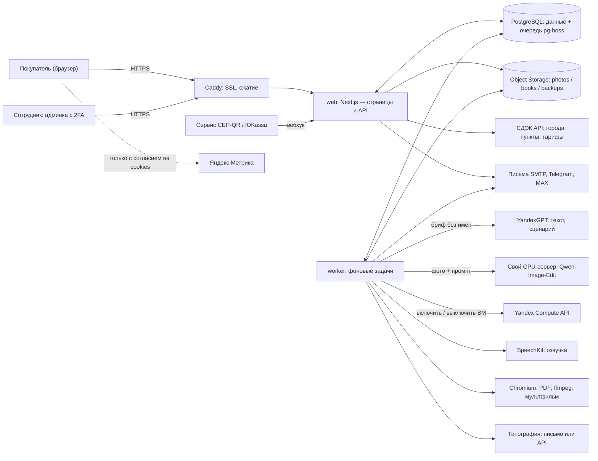
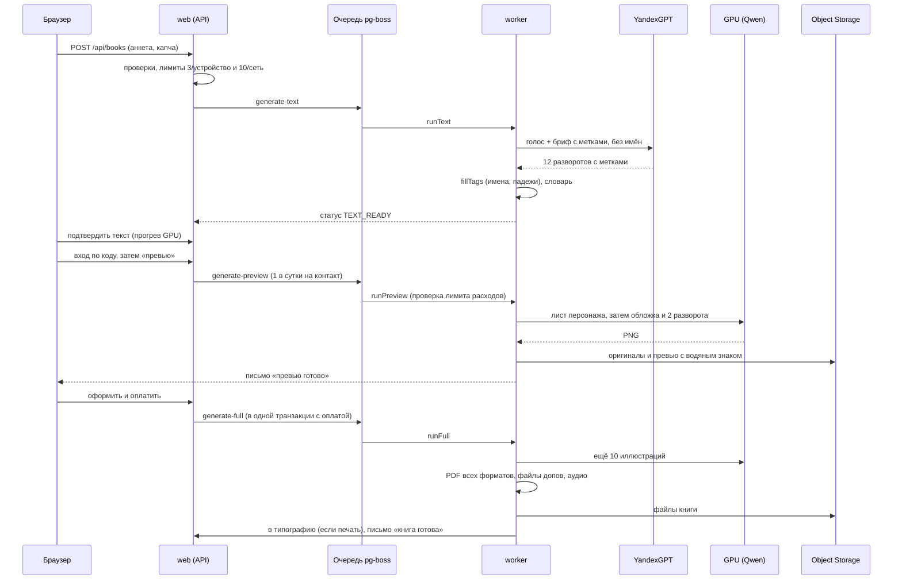
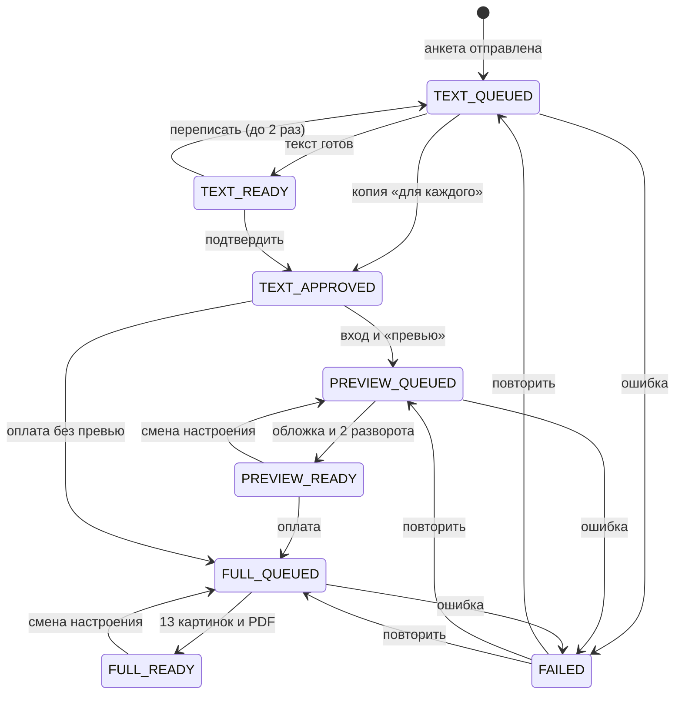
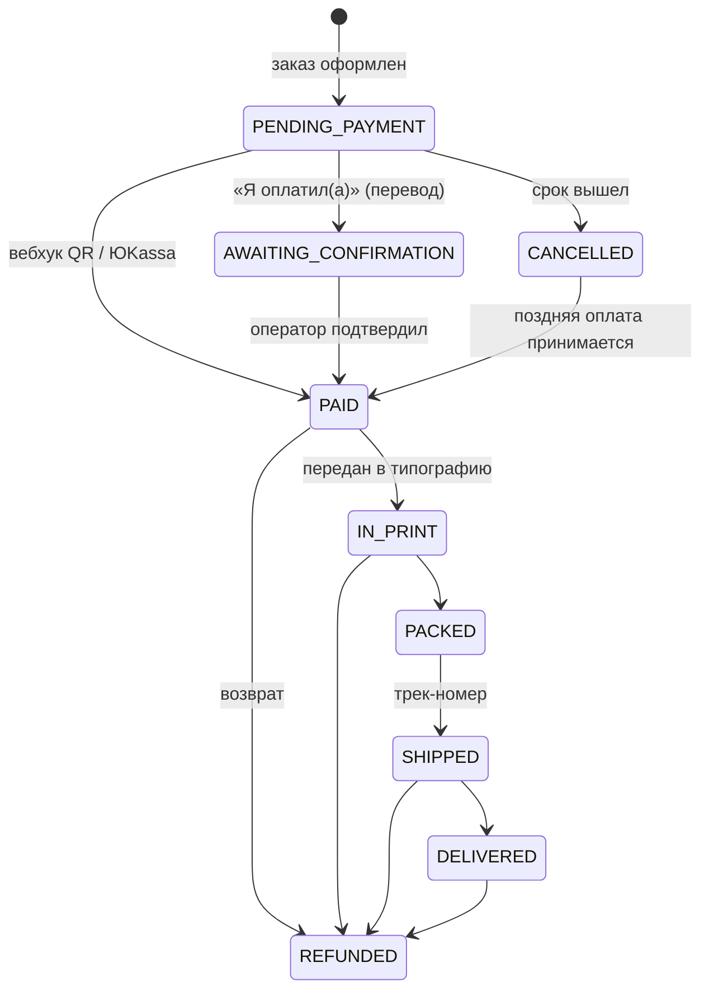

# Как работает БУКИМИ

Внутренний документ для владелицы и разработчиков. Описывает сайт, движок книг и серверную часть так, как они
устроены **в коде на 31.10.2026** (репозиторий `bookimi`). Каждое утверждение сверено с кодом; в скобках — файл,
где это видно. Если код и старые заметки расходятся, здесь написано так, как в коде (такие места отмечены).

Это технический документ, поэтому внешние сервисы названы прямо: текст пишет **YandexGPT**, иллюстрации рисует
**Qwen-Image-Edit** на собственном GPU-сервере в Yandex Cloud, озвучка — **Yandex SpeechKit**. На самом сайте
этих названий и слова «нейросеть» нет.

**Коротко о главном.**
- Покупатель проходит анкету, получает текст книги бесплатно, входит по коду из письма, получает бесплатное превью
  (обложка и 2 разворота с водяным знаком), оформляет и оплачивает заказ, после этого рисуется вся книга, собираются
  PDF и файлы допов, заказ уходит в типографию.
- Имя героя **никогда** не уходит во внешние сервисы: YandexGPT пишет текст с метками (`{ГЕРОЙ.дат}`), имена с
  падежами подставляем у себя.
- Пока ключи не подключены, всё работает в **демо-режиме**: текст из готовых шаблонов, картинки — свои SVG,
  оплата «понарошку».
- Сайт (`web`) и фоновый обработчик (`worker`) — один Docker-образ; база — PostgreSQL, очередь задач — в той же
  базе (pg-boss), файлы — Yandex Object Storage, HTTPS — Caddy.

## Общая схема



Порт 3000 приложения наружу не открыт — снаружи доступен только Caddy на 80/443 (`docker-compose.yml`).

---

# Часть А. Фронтенд: что видит покупатель и сотрудник

## А1. Витрина

| Страница | Адрес | Зачем | Где в коде |
|---|---|---|---|
| Главная | `/` | Промо-полоса, первый экран с **полкой книг** по макету владелицы, сезонная кнопка (ближайший праздник), «Избранное», витрина «фото → иллюстрация» (пока демо-рендер с пометкой «пример»), FAQ, отзывы (только опубликованные), подписка «−300 ₽» (видна, только если в настройках указан активный промокод) | `src/app/page.tsx`, `src/components/Home.tsx`, `src/components/Shelf.tsx`, `src/lib/shelf.ts`, `src/lib/storefront.ts` |
| Каталог | `/skazki` | Все книги с фильтрами (аудитория, повод, возраст); при выбранном поводе — разделы повода (см. Б2) | `src/app/skazki/page.tsx`, `src/components/StoryGroups.tsx` |
| Аудитории | `/dlya/[audience]` | Посадочные «детям / подросткам / взрослым / о питомцах»: сегменты, книги, поводы, вопросы | `src/app/dlya/[audience]/page.tsx` |
| Возраст | `/vozrast/[slug]` | SEO-посадочные для детских возрастов | `src/app/vozrast/[slug]/page.tsx` |
| Поводы | `/povody`, `/povod/[slug]` | Список поводов и страница повода с книгами в порядке разделов и сроком «заказать до» | `src/app/povod/[slug]/page.tsx` |
| Праздники | `/prazdniki` | «Ближайшие праздники» с датами по Москве и сроком заказа печатной книги | `src/app/prazdniki/page.tsx`, `src/lib/holidays-core.ts` |
| Страница книги | `/skazki/[slug]` | Как у Wonderbly: «живая обложка» (имя появляется по мере ввода), 3 разворота-образца, цены, допы аудитории, кнопка «Создать» | `src/app/skazki/[slug]/page.tsx`, `src/components/NamePreview.tsx` |
| Блог, документы | `/blog`, `/oferta`, `/politika`, `/vozvrat`, `/cookies`, `/soglasie/*`, `/kontakty` | Тексты; юридические — шаблоны, правятся в админке | `src/lib/legal.tsx` |
| Для поисковиков и ИИ-агентов | `/sitemap.xml`, `/robots.txt`, `/llms.txt`, `/catalog.json`, `/agents.md`, `/indexnow.txt`, `/og` (картинки для соцсетей), `/obrazec` (демо-разворот SVG) | Описание каталога, цен, допов и возрастной маркировки | `src/app/*.ts`, `src/lib/geo.ts`, `src/lib/og.ts` |

**«Скоро».** Настройка `storefront.soon` (`src/lib/settings.ts`): по умолчанию подростки, взрослые и питомцы — «скоро»,
плюс отметки отдельных книг полки. Книги таких аудиторий видны, но кнопка «Создать» выключена и стоит плашка
(`src/components/Soon.tsx`, `src/app/skazki/[slug]/page.tsx`, `src/app/dlya/[audience]/page.tsx`).
Важно: это только витрина — анкета `/sozdat` и API создания книги «скоро» не проверяют (см. «Известные ограничения»).

Тёмная тема: системная по умолчанию, переключатель в подвале (хранится в браузере, `src/components/ThemeToggle.tsx`).

## А2. Создание книги (анкета)

Анкета — один клиентский компонент `src/components/quiz/QuizWizard.tsx`; набор шагов считает `flowSteps()` в
`src/lib/flow.ts`. Страница `/sozdat` принимает параметры: `?skazka=` (книга выбрана), `?dlya=` (аудитория),
`?povod=` (повод), `?pol=` и `?segment=` (с полки главной), `?geroj=` (сохранённый герой из кабинета —
для напоминания о дне рождения) (`src/app/sozdat/page.tsx`). Текущий шаг пишется в адрес (`?step=`), поэтому
«Назад/Вперёд» браузера и перезагрузка не теряют место.

### Шаги по случаям

| Шаг | Книга выбрана заранее | Книга не выбрана | Книга о группе (детсад, класс) |
|---|---|---|---|
| 1. **Герои** | ✔ — кто герой (ребёнок / подросток / взрослый / питомец = аудитория), имя, фото или описание, доп. герои | ✔ | ✔ |
| 2. **Для кого и повод** | — (аудитория и повод известны) | ✔; пропускается, если в ссылке есть и `?dlya=`, и `?povod=` | как слева |
| 3. **Книга** | — | ✔ разделы повода: «к вашему поводу» → «Своя история» → «Тоже подойдут — впишем ваш повод» → остальные; фильтр по возрасту героя | как слева |
| 4. **Группа** | — | — | ✔ список детей (вставка списком, до 30 в детсаду, до 40 в классе вместе с героем), взрослые группы (до 3), галочка «книга для каждого» |
| 5. **Детали** | ✔ внешность, увлечения, роли доп. героев под сюжет, голос, стиль картинок, настроение, посвящение | ✔ | ✔ |
| → Текст | Сочиняем (обычно < 1 мин): прочитать, **переписать** (до 2 раз), поправить вручную, **подтвердить** | ✔ | ✔ |
| → Вход | Телефон (обязателен) + код на почту | ✔ | ✔ |
| → Превью | Обложка + 2 разворота с водяным знаком, 1 в сутки на контакт; можно 2 раза сменить настроение | ✔ | + превью первых 3 копий «для каждого» |
| → Оформление | `/kniga/[id]/kupit` | ✔ | одна доставка на всех, скидки за количество |

Повод книги, выбранной заранее: из ссылки `?povod=`, иначе единственный повод книги, иначе «без повода»
(ASSUMPTIONS.md, п. 43). Полоса прогресса считает только шаги анкеты; при книге о группе шагов на один больше.

**«Своя история».** Вместо готового сюжета — идея покупателя в 1–2 предложениях; `/api/ideas` предлагает 3 варианта
сюжета (YandexGPT или демо), покупатель выбирает (`src/app/api/ideas/route.ts`, `src/lib/gen/text.ts`).

**Согласия — один раз, в первой точке сбора данных** (`src/app/api/draft/consent/route.ts`, `src/lib/consent.ts`):
- перед первой загрузкой фото — две отдельные неотмеченные галочки: обработка персональных данных и фото
  (формулировка по аудитории: «как законный представитель» / «своё фото» / «фото питомца»);
- перед первым фото другого ребёнка группы — третья галочка «родители этих детей разрешили» (тип `GROUP_PHOTO`);
- без фото — галочка ПДн появляется на входе; рассылка — отдельная необязательная галочка на входе.
Согласия до входа привязаны к анонимной cookie и после входа переходят в аккаунт; повторно не спрашиваются.

**Фото и проверки** (`src/app/api/draft/photos/route.ts`, `src/lib/photo-process.ts`, `src/lib/photo-check.ts`).
Приём фото включается в Настройках (`flags.photoUploadEnabled`, по умолчанию **выключен** до проверки согласий
юристом); пока выключен — только описание словами. Фото обрабатывается сразу на сервере:
- тип по первым байтам, поворот по EXIF, метаданные удаляются, до 2048 px; портрет «голова и плечи» 1024×1024;
- лёгкое улучшение (медиана, уровни, резкость) — без «дорисовки» лица;
- отказ: меньше 500 px или сильный смаз; подсказки: лицо мелкое, темно/светло, низкий контраст, несколько лиц
  (тогда покупатель выбирает лицо на исходнике);
- поиск лица — эвристика по цвету кожи, а не модель; поэтому «лицо не нашли» — подсказка, не отказ;
- размер файла — до 15 МБ (ответ 413 с понятным текстом).
Фото других детей группы в генерацию картинок не идут — из них берётся только подсказка для описания.

**Вход** (`/vhod`, `src/app/vhod/LoginBox.tsx`, `src/components/OtpForm.tsx`) — почта + мобильный телефон
(обязателен по настройке `auth.phoneRequired`), 6-значный код приходит **на почту**; вход по SMS — только если
включён `auth.smsLogin` и настроен SMS-провайдер. Можно указать «Как к вам обращаться». После входа анонимные
книги и черновики этого браузера переходят в аккаунт (`src/lib/auth.ts`, `verifyOtp`).

**Превью** — страница `/kniga/[id]` (`src/components/book/BookFlow.tsx`) опрашивает `/api/books/[id]` и показывает
состояние книги: «сочиняем» → текст (переписать / править / подтвердить) → «рисуем» → превью. До оплаты картинки
отдаются только в уменьшенном виде с водяным знаком (`src/app/api/books/[id]/route.ts`). Здесь же — выбор
**настроения** иллюстраций и панель «книга для каждого в группе».

## А3. Оформление и оплата

`/kniga/[id]/kupit` → `src/components/book/Checkout.tsx`. Сумму **всегда** считает сервер (`/api/checkout/quote`,
`src/lib/pricing.ts`, `src/lib/orders.ts`), браузер присылает только выбор.

1. **Кто печатает книгу?** «Сам» (PDF) или «БУКИМИ» (печать). Печать можно выключить целиком (`flags.printEnabled`).
2. **Формат** (по умолчанию, меняется в админке, `src/lib/catalog-defaults.ts`): PDF 990 ₽; Мини 15×15 мягкая
   2490 / твёрдая 3490; Стандарт 21×21 мягкая 2990 / **твёрдая 3990 (по умолчанию)**; Альбом 28×21 4490; Большой
   30×30 5490. PDF входит в печатную книгу; если PDF уже куплен — его цена зачитывается.
3. **Допы по аудиториям** (`Addon.audiences`, `src/lib/addons-core.ts`; цены — ASSUMPTIONS.md, ДА3):

   | Аудитория | Допы по умолчанию |
   |---|---|
   | Дети | ростомер 790, упаковка с картой 490, наклейки 350, постер А3 590, раскраска PDF 290, «Читаю сам» 490 |
   | Подростки | постер А3 590, стикерпак 390, закладки 4 шт. 290, скетчбук А5 690, обои PNG 290 |
   | Взрослые | коробка премиум 690, открытки 6 шт. 490, календарь 2027 990, принт А3 590, закладка 190 (принт в раме 2490 — выключен, «другой подрядчик») |
   | Питомцы | постер 590, календарь 2027 990, открытки + наклейки 390, «паспорт питомца» 290 (магнит 350 — выключен) |
   | Дети, подростки, взрослые | аудиокнига (диктор) 390 |
   | Все | мультфильм 690; «своим голосом» +400 (дети и взрослые); второй экземпляр −30%; срочно +500 |

   Физические допы — только с печатью; цифровой доп дважды к одной книге не продаётся; доп чужой аудитории сервер
   отклоняет, даже если прислать его вручную.
4. **Доставка** (`src/components/book/CityInput.tsx`, `PvzPicker.tsx`, `src/lib/shipping.ts`, `src/lib/cities.ts`):
   - подсказка города с 2 букв — офлайн-список 1231 города (ё/е, раскладка, опечатки, сокращения «спб», «екб»),
     с ключами СДЭК — плюс малые пункты из API СДЭК (`/api/geo/cities`);
   - пункты выдачи СДЭК по городу с поиском по улице/метро, до 30 в ответе (`/api/geo/pvz`); без ключей —
     поле «код или адрес пункта» вручную; при оформлении сервер сверяет код пункта со списком СДЭК;
   - способы: СДЭК до пункта, СДЭК курьер, самовывоз из типографии (если указан адрес); Почта и Яндекс — выключены;
   - цена и срок: калькулятор СДЭК, без ключей — тариф из настроек с поправкой на расстояние от склада;
     до пункта СДЭК бесплатно от 2 книг (`shipping.freeShippingBooks`);
   - адрес «из прошлого раза»: адресная книга профиля (последние 3), иначе последний заказ (`pickPrefill`).
5. **Промокод.** Не суммируется со скидкой новичка (по приглашению «Приведи друга») и со скидкой за количество —
   берётся та, что больше в рублях. Промокод блогера подставляется сам по `utm_source` (`src/app/api/checkout/route.ts`).
6. Контакт получателя: имя и мобильный (+7…) — обязательны для печати.

После «Оформить» создаётся заказ, покупатель попадает на `/zakaz/[id]` (`src/app/zakaz/[id]/page.tsx`,
`src/components/book/PayBox.tsx`) и выбирает способ:
- **СБП по QR** — QR живёт 1 час; оплату подтверждает вебхук сервиса;
- **Перевод по реквизитам** с кодом заказа в комментарии → кнопка «Я оплатил(а)» → оператор подтверждает в админке;
  срок — 24 часа;
- **ЮKassa** — выключена (для перехода на ИП).

**Заказ и лента благодарностей.** На странице заказа — путь заказа по этапам «оформлен → оплачен → книга готова →
в типографии → в пути → получена» с датами и коротким словом команды на каждом этапе
(`src/app/zakaz/journey.ts`, `OrderTimeline.tsx`), сразу после оплаты — панель «Спасибо» (`ThanksPanel.tsx`).

## А4. Кабинет покупателя (`/kabinet`)

| Раздел | Что там | Код |
|---|---|---|
| Главная кабинета | «Мои книги», ближайшие дни рождения героев (60 дней), «Приведи друга»; приветствие по «Как к вам обращаться» | `src/app/kabinet/page.tsx`, `Birthdays.tsx` |
| Книга | Читалка (текст можно править бесплатно, после оплаты PDF пересобирается), скачивание файлов (PDF экран / А4 / печать 21 и 15 см, аудио, раскраска, обои), **перерисовка** одной иллюстрации (3 бесплатно, дальше 99 ₽ через поддержку), «Заказать печать (PDF зачтём)», «Второй экземпляр −30%», «Добавить к книге» (цифровые допы отдельным заказом), «Читаю сам» (запись по страницам) | `src/app/kabinet/kniga/[id]/BookCabinet.tsx` |
| Настроение | Меняется на странице книги `/kniga/[id]`: до оплаты — 2 раза бесплатно (обложка и 2 разворота); после оплаты — первая смена всей книги бесплатно, дальше — из лимита перерисовок | `src/components/book/BookFlow.tsx`, `src/app/api/books/[id]/action/route.ts` |
| Мультфильм | Панель мультфильма: купить, голос диктора, субтитры, пересборка, ссылка «Поделиться» на 30 дней; **«Озвучить своим голосом»** — отдельное согласие, запись по репликам в браузере или одним файлом | `CartoonPanel.tsx`, `src/app/kabinet/kniga/[id]/mult/*` |
| Мои герои | Сохранённые герои и даты рождения; кнопка ведёт в анкету с поводом «день рождения» | `src/app/kabinet/geroi/page.tsx` |
| Заказы | Список и путь каждого заказа | `src/app/kabinet/zakazy/page.tsx` |
| Уведомления | Каналы: почта, Telegram (привязка через бота), MAX; маркетинг отдельно | `src/app/kabinet/uvedomleniya/page.tsx` |
| Мои данные | Имя для обращения, адресная книга (правка/удаление), отзыв согласий, **выгрузка данных** (JSON), **удаление аккаунта** (подтверждение словом «УДАЛИТЬ») | `src/app/kabinet/dannye/*`, `src/app/api/me/route.ts` |
| Отзыв, поддержка, «Приведи друга» | Отзыв — только после оплаченного заказа, публикуется после модерации | `src/app/kabinet/otzyv`, `podderzhka`, `drug` |

## А5. Админка (`/admin`)

Вход — тот же код на почту, затем **обязательный второй фактор** (TOTP-приложение) на `/admin/2fa`. Права — `PERMS`
в `src/lib/auth.ts`.

| Раздел | Что делает | Владелец | Оператор | Маркетолог |
|---|---|---|---|---|
| Главная | Чек-лист «Готовность к продажам» (что не заполнено и что из-за этого выключено) | ✔ | — | — |
| Дашборд | Деньги, выручка 30 дней, лимит НПД с прогнозом, воронка, источники, аудитории, расходы на генерацию (покупатели и сотрудники отдельно), скорость сайта | ✔ | ✔ | ✔ |
| Заказы | Карточка заказа, статусы, трек-номер, передать в печать / перепечатать, возврат | ✔ | ✔ | — |
| Переводы | Подтверждение переводов «Я оплатил(а)» | ✔ | ✔ | — |
| Книги покупателей | Просмотр текста/иллюстраций и PDF для поддержки (каждое открытие — в журнал) | ✔ | ✔ | — |
| Исходные фото детей | Только владелец | ✔ | — | — |
| Поддержка | Обращения | ✔ | ✔ | — |
| Триггеры | Правила писем, контрольная группа, статистика, тестовая отправка | ✔ | — | ✔ |
| Промокоды | Создание, лимиты, сроки, промокоды блогеров по `utm_source` | ✔ | — | ✔ |
| SEO и блог | Тексты страниц поводов и сюжетов, статьи блога | ✔ | — | ✔ |
| Праздники | Список, правила дат, «показывать за N дней» | ✔ | смотрит | ✔ |
| Отзывы | Модерация | ✔ | ✔ | ✔ |
| Каталог | Форматы, допы (цены, аудитории, изготовитель), стили иллюстраций, сюжеты (название, описание, обложка, вкл.) | ✔ | — | — |
| Настройки | Все разделы (см. В14) | ✔ | — | — |
| Команда | Роли сотрудников | ✔ | — | — |
| Журнал | AuditLog: действия сотрудников, безопасность, алерты | ✔ | — | — |

Маркетолог по замыслу не видит персональных данных (`seesPersonalData`).

## А6. Что хранится в браузере

| Где | Ключ | Что | Срок |
|---|---|---|---|
| localStorage | `bookimi.quiz.v3` | Черновик анкеты: ответы, шаг, **только id фото** (не сами фото). Удаляется после создания книги | до очистки |
| localStorage | `bookimi.heroName` | Имя, введённое в «живой обложке» страницы книги | до очистки |
| localStorage | `bk_theme` | Тема оформления | до очистки |
| cookie, httpOnly | `bk_anon` | Анонимный id браузера: черновики, книги и согласия до входа | 1 год |
| cookie, httpOnly | `bk_session` | Сессия (в базе хранится только хэш) | покупатель 30 дней, сотрудник 12 часов |
| cookie, httpOnly | `bk_ref`, `bk_utm` | Код приглашения и UTM-метки | 30 дней |
| cookie | `bk_consent` | Выбор в баннере cookies; Метрика грузится только при «с аналитикой» | 1 год |

(`src/middleware.ts`, `src/lib/auth.ts`, `src/components/CookieBanner.tsx`, `QuizWizard.tsx`.) Данные получателя и
адреса в браузере не хранятся — только в профиле на сервере.

## А7. Демо: два разных «демо»

1. **Сервер в демо-режиме** (`DEMO_MODE=1`): тот же сайт, но коды входа показываются на экране, оплата QR —
   тестовая страница `/api/payments/demo` (в продакшне 404), чеки не фискальные (`/chek/[id]`), в админку можно без
   2FA, если она не включена. Текст и картинки — демо, пока в Настройках → «ИИ-провайдеры» стоит «demo».
2. **Демо-стенд** — один HTML-файл (~900 КБ) `tools/demo/out/bookimi-demo.html`, собирается `tools/demo/build.mjs`.
   Настоящие модули сайта работают прямо в браузере: «база» — localStorage `bookimi.demo.v1`, фото — только в памяти
   вкладки, API — перехват запросов (`tools/demo/api.ts`). Отличия: лимиты по 999 и кнопка «Сбросить лимиты»; пробные
   стили видны всегда; мультфильм проигрывается на canvas голосом браузера (MP4 не рендерится); PDF и файлы допов
   не собираются; городов 400 вместо 1231; пункты СДЭК — выдуманные. Системные промпты в стенд не попадают.
   Версии стенда — `docs/DEMO-REVISIONS.md` (rev 01–06, последняя — полка главной и «скоро»).

---

# Часть Б. Движок: контент и генерация

Весь контент — код в `src/content/`, архитектура — `docs/content/ARCHITECTURE.md`. Сейчас в реестре
(проверено запуском `validateContent({strict:true})` — 0 ошибок): **35 сюжетов** (дети 15, подростки 7, взрослые 7,
питомцы 6; из них 5 — книги о группе), **14 голосов** текста (3 в стихах), **28 стилей** картинок (15 рабочих + 13
пробных), **11 настроений**, **11 сегментов**, **26 поводов**. В README ещё написано «30 сюжетов, 15 стилей» —
это без книг о группе и без пробных стилей.

## Б1. Из чего складывается книга

```
Профиль аудитории → Сегмент → Сюжет (12 разворотов) → Голос текста → Стиль картинок → Настроение
                                     ↑ крючки повода
```

| Слой | Что это | Файл |
|---|---|---|
| **Аудитория** | CHILD, TEEN, ADULT, PET — она же «вид героя» (child/teen/adult/pet) | `src/content/profiles.ts`, `types.ts` |
| **Сегмент** | Подгруппа с правилами: дети 2–4 / 5–7 / 8–10; подростки 11–13 / 14–17; взрослые: пара, родитель, бабушка-дедушка, друг; питомцы: собака, кошка. В сегменте — длина текста, тон, **запреты** (taboo), поля анкеты героя, допустимые голоса и стили | `profiles.ts` (`SEGMENTS`) |
| **Сюжет (Plot)** | Ровно 12 разворотов: текст с метками + сцена для картинки (по-английски, без имён); голос и стили по умолчанию; тема демо-рисунка; доп. герои (роли, min/max); крючки поводов; у книг о группе — `group` | `src/content/plots/{kids,teens,adults,pets,groups}.ts` |
| **Голос текста (TextStyle)** | Системный промпт YandexGPT: «Повторялка на ночь», «Тихая сказка перед сном», «Русская народная сказка», «Сказка в стихах, пушкинская», «Весёлые стихи», «Уютное приключение», «Фэнтези-квест с юмором», «Детектив», «Научная фантастика», «Комикс», «Наша история», «Шуточный эпос», «Лирические стихи», «От лица питомца» | `src/content/text-styles.ts` (только сервер) |
| **Стиль картинок (ArtStyle)** | Промпт и негатив для Qwen + облик для демо-SVG. Рабочие: 7 детских, 3 подростковых, 2 взрослых, 3 для питомцев. **Пробные** (13, по референсам владелицы, `docs/content/STYLE-REFERENCES.md`) видны только при `art.showTrialStyles` | `src/content/art/*.ts`, `art/trial.ts` |
| **Настроение (Mood)** | Добавка к промпту и тонировка демо: как задумал художник, тёплое, волшебное, весёлое, сонное (дети и питомцы), праздничное, приключенческое, нежное, ретро, зимнее, романтическое (взрослым и подросткам от 14) | `src/content/moods.ts`, `art/mood.ts` |
| **Реестр** | Доступ и проверка: `getPlots`, `plotBySlug`, `hooksFor`, `applyOccasion`, `plotSections`, `validateContent` | `src/content/registry.ts` |

Каталог сайта читает таблицу `Story` (её заполняет `prisma/seed.ts` из реестра; витринные тексты, SEO, обложку и
включение правят в админке, seed их не перезаписывает); если база пуста — каталог берётся прямо из реестра
(`src/lib/catalog.ts`). «Своя история» — служебная строка `Story` со slug `svoya-ideya`.

**Проверка контента** `validateContent()` ловит: не 12 разворотов, плохие метки, `нашёл{Р:|а}` вместо
`{Р:нашёл|нашла}`, ссылку на `ДОП2` при `extras.min < 2`, имя внутри стихотворной строки, больше 4 имён в стихах,
неравные по слогам формы рода, «наш герой» о девочке, пустой `default`-крючок без `{ПОВОД}` и т. д. Тест
`tests/content.test.ts` запускает её в строгом режиме.

## Б2. Поводы и порядок книг

- Любой сюжет можно подарить на любой повод. Крючок повода берётся так (`hooksFor`): свой крючок сюжета для этого
  повода → свой `default` сюжета (обязан содержать `{ПОВОД}`) → общий крючок из `src/content/occasions.ts`.
  `applyOccasion` дописывает начало крючка в разворот 1, финал — в разворот 12, сцены — к сценам.
  Пустой крючок означает «сюжет уже об этом поводе».
- Повод в тексте — короткое слово с родом и падежами (`OCCASION_WORDS`: «годовщина», «новоселье», «выход на
  пенсию»…); «свой повод» не склоняется; в начале фразы — с заглавной.
- **Порядок на странице повода, в каталоге и в анкете один** — `sectionsOf()` в `src/content/sections.ts`
  (обёртка `plotSections` в реестре):
  - **core** — написаны для повода; **fits** — повод вплетается естественно (к Рождеству и Старому Новому году —
    ещё новогодние); остальные — generic;
  - есть core: `core → «Своя история» → «Тоже подойдут — впишем ваш повод» (fits) → остальные`;
    нет core, «Без повода», «Свой повод»: «Своя история» первой;
  - «сильные» поводы (выпускные, первый класс, брат/сестра, свадьба, годовщина, пенсия, питомец, Новый год, день
    рождения) прячут generic за кнопкой «Показать все книги (N)».
  Таблица «повод × аудитория» — `docs/content/OCCASIONS-MATRIX.md`.

## Б3. Метки и склонение

Модель и шаблоны пишут не имена, а метки; подстановка — `fillTags()` в `src/lib/declension.ts`, проверка —
`checkTags()` в `src/content/tags.ts`. Падежи: `им род дат вин тв пр`.

| Метка | Что подставляется |
|---|---|
| `{ГЕРОЙ.дат}`, `{ЛАСКОВО.им}` | Имя героя / домашнее имя (для питомца — кличка) в падеже |
| `{ДОП1.вин}`…`{ДОП3.*}`, `{ДОПЫ.дат}` | Доп. герои по порядку; все вместе списком «Ане, Пете и Маше» |
| `{Р:м\|ж}`, `{Р:м\|ж\|ср}`, `{Р1:…}`…`{Р3:…}` | Форма слова по полу героя / доп. героя |
| `{МН:один\|много}` | По числу доп. героев |
| `{ПОВОД}`, `{ПОВОД.дат}`, `{ВОЗРАСТ}` | Повод словом; возраст («5 лет») — только когда точно известен |
| `{ГРУППА.дат}`, `{ДРУГ1}`…`{ДРУГ14}`, `{РДn:м\|ж\|мн}`, `{МН_ГРУППЫ:…}` | Дети группы; слоты по разворотам |
| `{ВОСПИТАТЕЛЬ.дат}`, `{ВОСПИТАТЕЛИ}`, `{РВ:м\|ж}` | Взрослые группы: имя-отчество склоняется целиком («Марии Ивановне», «Ивану Петровичу») |
| `{ПЕРЕКЛИЧКА}` | Все имена через « · », герой посередине — разворот «Наш класс» |
| `[[?УСЛОВИЕ: текст \|\| иначе]]` | Блок, который появляется только если в группе есть дети / взрослые / больше 8 и т. п. |

Что умеет склонение (`declineName`, `guessGender`, `normalizeName`):
- **Имена** — типичные и домашние формы, «Павел → Павла», «Наталья → Натальей», «Любовь», «Лев»; имя всегда с
  заглавной; латиница (Nikita, Ilya — мужские, Ann, Kate — женские); «Саша К.» без двойной точки.
- **Пол по имени**, если не указан (-а/-я — женский, кроме Илья, Никита, Миша, Саша…); для группы неоднозначные
  (Саша, Женя, Валя…) анкета **спрашивает** (`src/lib/roster.ts`).
- **Отчества** — только у взрослых группы; «Ильич/Лукич» → «Ильичом», прочие «-ович» → «-овичем».
- **Предлоги** перед подставленным именем правятся сами: «об Ане», «о Юле», «со Львом», «ко Всеволоду».
- **Название** с `[Имя]` — через `src/content/title.ts`: падеж по предлогу перед именем («Сказка о [Имя]» → «о Маше»).
- **Группы до 40**: в книге до 14 слотов `{ДРУГn}`; если детей больше — слоты получают подряд идущие кучки по 2–3
  имени, так что каждый ребёнок назван ровно один раз (`distributeMembers`). Списки длиннее 8 имён продолжаются
  следующими фразами. Группа больше 9 — разворот-перекличка («общая фотография», герой в центре).
- Вставка списка группы: строки, запятые, «;», номера, пометки «(м)/(ж)»; повторы и совпадение с героем — просим букву
  фамилии; сверх лимита — лишние имена остаются в поле с сообщением (`addWithLimit`).

## Б4. Текст

`runText()` в `src/lib/gen/pipeline.ts` → провайдер из Настроек → «ИИ-провайдеры» (`ai.text`, `src/lib/gen/text.ts`).

- **Демо** (`DemoTextProvider`) — заранее написанные развороты сюжета + крючки повода + фразы доп. героев и
  увлечений; для «своей истории» — сюжет сегмента в выбранном голосе, название — из идеи. Бесплатно.
- **YandexGPT** (`YandexGptProvider`): системный промпт = голос книги; сообщение = **бриф** (`brief()`):
  сегмент (длина, тон, запреты), «Главный герой: {ГЕРОЙ.им}», возраст (дети/подростки), питомец/взрослый — детали
  анкеты, увлечения, внешность, доп. герои метками `{ДОПn}` с ролями, группа (число детей и слоты, без имён),
  повод метками с грамматикой, заготовки крючков, **план 12 разворотов сюжета**; для своей идеи — идея.
  Модель `yandexgpt/latest`, `maxTokens 8000`, таймаут 120 с, температура 0,6 (+0,15 на каждое «Переписать»).
  Ответ — JSON с 12 разворотами; для готовых сюжетов **сцены для картинок берутся из сюжета**, а не от модели.
- **Обезличивание** (`src/lib/gen/redact.ts`): всё, что покупатель написал свободным текстом (внешность, характер
  питомца, «как познакомились», воспоминания, свой повод, идея), перед отправкой проходит замену: имя, домашнее имя,
  доп. героев во всех падежах и ласковых формах (Аня ↔ Анна/Анечка/Анюта…) → метки; дети группы → «друг из группы»;
  телефоны, почта, ссылки, @ники и числа от 6 цифр удаляются. Редкое домашнее имя, которого нет в таблице,
  распознать нельзя — поэтому под полями подсказка «Имена здесь не нужны».
- **После ответа**: `personalize()` подставляет имена (`fillTags`), `checkText()` (`src/lib/moderation.ts`) —
  словарный фильтр (грубость, насилие, ссылки); не прошло — ошибка генерации.
- **Лимиты**: 3 сказки в сутки с устройства (`limits.textsPerDevice`) и 10 с подсети IP (`limits.textsPerIp`);
  «Переписать» — 2 раза; суточный лимит расходов (Б9). Капча Yandex SmartCaptcha при создании книги (если задан ключ).
  Анкета тоже проверяется словарём до создания книги.

## Б5. Иллюстрации

`drawPages()` в `pipeline.ts` → `imageProvider()` в `src/lib/gen/image.ts` (`ai.image`: demo / qwen / kandinsky).
Номер 0 — обложка, 1–12 — развороты. Превью = 0, 1, 2; после оплаты дорисовываются недостающие (всего 13).

**Сборка промпта сцены** (`scenePrompt()`):
1. «The first images are references of the main hero…» — если есть фото;
2. `Scene:` — сцена разворота (из сюжета, с реквизитом повода и группой словами: «a group of 14 kindergarten children»);
3. описание героя по виду, если стиль «чужой» аудитории (например, детская акварель для кошки);
4. детали внешности из анкеты (обезличенные: «the hero», «the friend»);
5. доп. герои ролями;
6. `Style:` — промпт стиля (`src/content/art/*.ts`);
7. **фраза сохранения личности** `IDENTITY_CLAUSE` — ко всем стилям: «тот же человек, меняется только техника, не
   превращать в животное, маскота или чужого персонажа» (для питомца — своя);
8. «оставить спокойные поля для обреза»;
9. **настроение** — `moodPrompt()` дописывает «Mood: …» и негатив.
Негатив: негатив стиля + общий негатив личности, минус слова, спорящие с видом героя; если сцена просит костюм —
запрет костюмов снимается (`filterNegative`).

**Лист персонажа.** Если есть фото и провайдер настоящий, один раз на книгу рисуется лист «4 вида героя»
(`sheet()`), он хранится в бакете `books` и дальше идёт референсом к каждой сцене вместе с фото.

**GPU-сервер** (`tools/gpu-server`, FastAPI + Qwen-Image-Edit-2511): запрос `POST /v1/edit` с base64-картинками,
обложка 1536×1536, разворот 2048×1024, 30 шагов для превью и 40 для книги, фиксированный seed. Ответ с оценкой
`nsfw > 0.5` отклоняется. Цена считается по секундам GPU × «цена часа» из настроек (300 ₽ — ориентир).
Управление ВМ (`src/lib/gen/gpu.ts`): режимы **по требованию** (включить при первом запросе, ждать до 15 минут,
выключить после 10 минут простоя), **по расписанию** (держать включённым в часы пик, по умолчанию 10:00–23:00 в
ноябре–декабре), **всегда**. Прогрев начинается, когда покупатель подтверждает текст. Время простоя записывается
в расходы как «накладные GPU».

**Демо-рендер** (`DemoImageProvider` → `renderDemoSpread`, `src/content/art/render.ts`): SVG без GPU — фон темы
сюжета, реквизит по словам сцены (`art/props.ts`: река, ёлка, окно, сани…), тон неба, герой и доп. герои по виду
и внешности, до 40 фигур группы рядами, палитра и фактура стиля, тонировка настроения. Цвет одежды один на всю
книгу. Подпись «демо-иллюстрация».

**Сохранение** (`savePage`): оригинал + превью (до 900 px, JPEG 70, водяной знак) в бакет `books`; старая версия
удаляется. Перерисовка — та же сцена с другим вариантом; после оплаты PDF пересобирается.

## Б6. PDF и файлы допов

`src/lib/pdf.ts` — HTML-вёрстка → Chromium → PDF. После оплаты (`renderBookFiles`) делаются:
`pdf-screen` (для экрана), `pdf-a4` (домашняя печать, разворот на листе А4), `pdf-print-210` и `pdf-print-150`
(для копицентра: страница + вылеты 3 мм, безопасные поля 5 мм). Для заказа с печатью — `print-block` и
`print-cover` под заказанный формат (обложка: задняя + корешок + передняя; для твёрдой — с загибами; блок 26 страниц:
посвящение + 24 страницы + финал). Разметка текста общая с экраном (`src/lib/spread-markup.ts`: строки стихов,
плашки комикса, звуки жирным). Подпись «Сказка, в которой…» — только детям, остальным «История, в которой…»;
возрастная маркировка: дети и питомцы 0+, подростки 6+, взрослые 12+.

Файлы допов (`src/lib/addon-files.ts`) — по иллюстрациям книги, с вылетами 3 мм и TrimBox: постер/принт А3, стикеры
А5 + контур резки, закладки 5×15, обложка скетчбука, открытки 10×15, **календарь 2027** А4 (13 листов, праздники и
переносы 2027 — `src/lib/calendar.ts`), «паспорт питомца», открытка и наклейка премиум-коробки; обои PNG
1170×2532 и 2560×1440. Раскраска — иллюстрации в контур (sharp) → PDF А4. Аудиокнига — SpeechKit (`runAudio`).
Ростомер и упаковку с картой типография делает по своему шаблону.

## Б7. Мультфильм по книге

Задача `generate-cartoon`, по одному за раз (`src/lib/gen/cartoon.ts`, `cartoon-script.ts`, `cartoon-render.ts`):
1. **Сценарий** — 14 реплик (название, 12 разворотов, «Конец» + посвящение), ~220–260 слов на 2 минуты. YandexGPT
   сжимает текст книги с метками (имена обезличены, посвящение в модель не уходит), ответ проверяется; иначе — по
   правилам (`cartoonScript`). Для мультфильма своим голосом сценарий после начала записи не меняется.
2. **Голос** — диктор SpeechKit по аудитории (дети — Алёна, подростки — Филипп, питомцы — Джейн; можно сменить) или
   **свой голос**: записи покупателя по репликам, проверка формата по сигнатуре, отказ беззвучной записи, очистка
   (срез низа, шумоподавление, обрезка пауз), общая громкость −16 LUFS. Клонирования голоса нет, обработка — ffmpeg
   у нас.
3. **Рендер** (ffmpeg на CPU): наезд/панорама камеры, у демо-картинок — параллакс слоями, переходы, частицы по
   теме, субтитры Nunito, синтезированная музыка и шелест (без чужих записей), громкость −16 LUFS.
   Выход: MP4 1080×1080 25 fps, вертикальный 720×1280 и постер.
4. Письмо «Мультфильм готов»; ссылка «Поделиться» — случайный токен на 30 дней, `noindex`.
Пересборка: 1 бесплатная при смене голоса/субтитров/текста; своим голосом — до 3 сборок; упавший рендер — повтор
бесплатно. Записи голоса удаляются через 30 дней после выдачи (задача в 03:40) или сразу по кнопке/отзыву согласия.

## Б8. Проверки качества (сводно)

| Где | Проверка |
|---|---|
| Контент | `validateContent()` (метки, стихи, крючки, роли) — тест в CI |
| Анкета | zod-схема `AnswersV2`, словарь недопустимых слов, капча, подростки 11–17 лет, сюжет своей аудитории, число доп. героев |
| Фото | размер, резкость, яркость, контраст, размер лица, несколько лиц |
| Текст | обезличивание до отправки, `checkText()` после, JSON из 12 разворотов, правка покупателем тоже проходит словарь |
| Картинки | сцены из проверенных сюжетов, фраза сохранения личности, NSFW-оценка с GPU |
| Сборка | `npm run check:bundle-secrets` — в клиентском коде нет ключей и системных промптов |

## Б9. Одна книга от анкеты до файлов



---

# Часть В. Бэкенд

## В1. Модель данных

Схема — `prisma/schema.prisma`, миграции `0001…0008` в `prisma/migrations`.

| Группа | Таблицы | Связи и смысл |
|---|---|---|
| Люди и вход | `User`, `OtpCode`, `Session`, `Consent` | Пользователь (роль CUSTOMER / OWNER / OPERATOR / MARKETER), коды входа (хэш), сессии (хэш токена, отметка 2FA), согласия (тип, версия документа, user или анонимный id) |
| Каталог | `Story`, `Occasion`, `IllustrationStyle`, `ProductFormat`, `Addon` | Сюжеты (из реестра), поводы, стили, форматы и допы с ценами и аудиториями |
| Книга | `Hero`, `Photo`, `QuizDraft`, `Book`, `BookPage`, `BookFile`, `Cartoon` | Книга → её герои → их фото; страницы 0–12 (ключи картинки и превью, текст, версия); файлы (PDF, печать, аудио, допы, мультфильм); `params` — снимок анкеты; `parentBookId` — копия «для каждого» |
| Расходы и лимиты | `GenerationCost`, `GenerationLimit` | Каждая операция генерации в копейках (флаг `staff`); суточные счётчики по хэшу контакта/устройства |
| Деньги | `Order`, `OrderItem`, `Payment`, `Receipt`, `PromoCode`, `Referral` | Заказ → строки (формат/доп, у каждой своя книга), платежи (ключ идемпотентности), чеки НПД |
| Исполнение | `PrintHouse`, `PrintJob`, `Shipment` | Типография, передача в печать, отправление (метод, адрес, код пункта СДЭК, трек) |
| Маркетинг | `TriggerRule`, `TriggerRun`, `FunnelEvent`, `NotificationPref`, `Review`, `BlogPost` | Правила писем, факты отправки/контроля, воронка, каналы, отзывы, блог |
| Служебное | `Setting`, `AuditLog`, `SupportTicket`, `WebVital` | Настройки (ключ → JSON), журнал, поддержка, скорость сайта |

### Статусы книги (`BookStatus`)



`DRAFT` есть в схеме, но новые книги сразу создаются в `TEXT_QUEUED` (`src/app/api/books/route.ts`). Оплата
ставит `paidFull = true`; именно этот флаг (а не статус) открывает PDF и полноразмерные картинки.

### Статусы заказа (`OrderStatus`)



Автоотмена (`src/worker/jobs.ts`, каждые 5 минут): QR — через 1 час, перевод — через 24 часа, заказ без выбранного
способа — через 48 часов. «Я оплатил(а)» автоматически не отменяется — решает оператор. Заказ только с PDF после
оплаты остаётся в `PAID`.

## В2. API (группы)

| Группа | Маршруты | Примечание |
|---|---|---|
| Вход | `/api/auth/request`, `/verify`, `/logout` | Код на почту; лимиты 5 запросов кода на адрес и 30 на IP в сутки; 5 попыток ввода; срок кода 10 минут |
| Анкета | `/api/draft/consent`, `/api/draft/photos`, `/api/ideas`, `/api/continue` | Согласия, фото до книги, варианты «своей истории», «продолжить незаконченную книгу» |
| Книга | `/api/books` (создать), `/api/books/[id]` (GET состояние, PATCH правка текста), `/action` (rewrite, approve, consent, preview, redraw, mood, retry), `/photos`, `/bulk`, `/download`, `/voice` («Читаю сам»), `/cartoon`, `/cartoon/voice` | Доступ — только владельцу книги (`ownBook`: аккаунт или анонимная cookie); сотрудникам чужие книги здесь не открываются |
| Заказ | `/api/checkout/quote`, `/api/checkout`, `/api/orders/[id]` (pay, claim) | Только вошедшему покупателю |
| Оплата | `/api/payments/webhook/[provider]` (sbp, yookassa), `/api/payments/demo` (только демо) | См. В6 |
| Гео | `/api/geo/cities`, `/api/geo/pvz` | Без персональных данных, кэшируются |
| Кабинет | `/api/me` (выгрузка, имя, адреса, каналы, отзыв согласий, удаление), `/api/reviews`, `/api/support`, `/api/newsletter`, `/api/consent/cookies` | |
| Админ | `/api/admin/books/[id]`, `/download` + серверные действия `src/app/admin/actions.ts` | Права PERMS, журнал |
| Служебные | `/api/health` (БД + очередь), `/api/vitals` (скорость), `/api/telegram/webhook` (привязка чата), `/api/files` (выдача локального хранилища по подписи) | |

## В3. Вход и сессии

- **Покупатель:** почта + мобильный телефон, 6-значный код на почту (`src/lib/auth.ts`). Если отправка письма не
  удалась — ответ 503 с понятным текстом и код аннулируется. Телефон, закреплённый за другим аккаунтом, не переносится.
  Сессия — 30 дней, cookie `bk_session` httpOnly, в базе хэш.
- **Сотрудник:** тот же вход, затем **TOTP** (`src/lib/admin.ts`, `src/app/admin/2fa`). Сессия — 12 часов.
  Ключ TOTP хранится зашифрованным (AES-256-GCM). При включении выдаются **10 кодов восстановления** `xxxx-xxxx`
  (в базе — хэши, показываются один раз; можно перевыпустить). Неверные коды: не больше 5 за 15 минут на сотрудника и
  на IP, проверка под `pg_advisory_xact_lock` (параллельный подбор не проходит), на пятой — сессия завершается и
  владельцу алерт; вход кодом восстановления — тоже алерт.
- **Повторный код для чувствительных действий** (код 2FA не старше 10 минут, `requireAdmin(..., { fresh: true })`):
  подтверждение перевода, возврат, цены форматов и допов, типографии, роли сотрудников, и разделы настроек
  «Реквизиты», «Налоговый режим», «Способы оплаты», «Почта и каналы», «Аудио», «Мультфильм», «Книга для каждого»,
  «Приведи друга», «Алерты». Без свежего кода — переход на `/admin/2fa?reauth=1`, после кода действие повторяют.

## В4. Роли

Владелец — всё. **Оператор** (подрядчик по ГПХ) — заказы, переводы, печать, поддержка, книги покупателей
(без исходных фото), отзывы, дашборд, просмотр праздников. **Маркетолог** — дашборд, триггеры, промокоды, SEO и блог,
праздники, отзывы; без книг, фото и PDF. Таблица — А5, источник — `PERMS` в `src/lib/auth.ts`.

## В5. Лимиты и потолки расходов

| Лимит | По умолчанию | Для сотрудников |
|---|---|---|
| Сказок в сутки с устройства / с подсети IP | 3 / 10 | без лимита |
| Превью в сутки на контакт | 1 | без лимита |
| «Переписать» / бесплатные перерисовки | 2 / 3 (дальше 99 ₽ через поддержку) | без лимита |
| Смена настроения до оплаты | 2 | без лимита |
| **Суточный лимит расходов на генерацию** | **3000 ₽** (`limits.dailySpendRub`) | **свой — 1000 ₽** (`limits.staffDailySpendRub`) |
| Частота запросов к API | в памяти: например, книги — 10/мин, действия с книгой — 30/мин, гео — 120/мин с IP | те же |

Как работает потолок расходов (`src/lib/staff.ts`, `src/lib/limits.ts`): сумма `GenerationCost` за сегодняшние сутки
по Москве. Если лимит исчерпан — текст и превью **не теряются**, а ждут в очереди и повторяются через 15 минут;
владельцу алерт при 80% и 100%. **Оплаченные книги лимитом не останавливаются.** Книга считается «сотрудника», если
её владелец — сотрудник; расходы сотрудников идут отдельной серией на дашборде. Счётчики лимитов хранят хэш контакта,
а не сам адрес.

## В6. Оплата

Провайдеры — `src/lib/payments.ts`, логика — `src/lib/orders.ts`.

- **СБП-QR**: универсальный адаптер (`PAYMENT_SBP_API_URL`): создаёт QR с ключом идемпотентности, вебхук
  `/api/payments/webhook/sbp` с HMAC-подписью `x-signature`. Конкретный сервис для самозанятых ещё не выбран.
  В демо — тестовая страница.
- **Перевод**: реквизиты + код заказа `BK-XXXXXX` → «Я оплатил(а)» → оператор подтверждает (свежий код 2FA).
- **ЮKassa**: готова, выключена; вебхук перепроверяет статус запросом к API ЮKassa; возврат через API с проверкой ответа.

Защита от двойных списаний и гонок:
- «Оплатить» тем же способом, пока заказ ждёт и срок не вышел, возвращает **тот же** платёж (`startPayment`,
  `SELECT … FOR UPDATE` по заказу).
- Вебхук: неверная подпись — 401 и запись в журнал; чужой платёж — 200; сумма не совпала с заказом — 409 и журнал;
  отказ не перезаписывает прошедший платёж; выключенный способ — 404.
- `markPaid`: в **одной транзакции** блокирует платёж и заказ, меняет статус условно, засчитывает промокод одним
  условным UPDATE (не сверх лимита), ставит `paidFull` и **кладёт задачи генерации в очередь в той же транзакции**
  (оплата без задачи невозможна). Второй успешный платёж по оплаченному заказу → `needs_refund`, алерт «вернуть
  деньги», без чека и писем. После коммита — чек, письма, реферал, аналитика, триггеры, лимит НПД; сбой любого шага
  не ломает оплату (алерт владельцу).
- Возврат — только из оплаченных статусов и один раз; после полного возврата файлы книги закрываются, если она не
  оплачена другим заказом; чек аннулируется (иначе — алерт «аннулируйте вручную»).

## В7. Чеки НПД и годовой лимит

`src/lib/npd.ts`. Режимы (`NPD_PROVIDER`): чек приходит от платёжного сервиса в вебхуке; API партнёра ФНС;
**ручной (по умолчанию)** — оператор формирует чек в «Мой налог» и вставляет ссылку в админке; демо — с пометкой
«не фискальный». В чеке — услуга «Изготовление персонализированной книги … на заказ». Доход с 1 января считается по
оплаченным заказам; лимит 2,4 млн ₽ (`tax.npdYearLimitRub`); на дашборде прогноз даты; письмо владельцу при 80% и
95% (задача каждый день в 9:00). При режиме «ИП» чек НПД не формируется — это должна делать касса ЮKassa.

## В8. Заказ → типография → доставка

1. После оплаты `runFull` дорисовывает книгу, собирает PDF, блок и обложку печати и файлы допов
   (`src/lib/gen/pipeline.ts`). Если книга уже была готова (докупили печать после PDF) — только недостающие файлы.
2. `sendToPrint` (`src/lib/print.ts`) — только когда заказ оплачен, все книги `FULL_READY`, блок, обложка и файлы
   допов готовы. Типографии уходит **письмо** (или POST на её API): формат, количество (+второй экземпляр), допы,
   «срочно», ссылки на файлы (подписанные, 7 дней), способ доставки, получатель и адрес, требования к бумаге.
   Допы «другого подрядчика» в типографию не уходят — владельцу алерт «закажите вручную». Статус → `IN_PRINT`.
3. Дальше оператор вручную ведёт статусы в админке: «упакован», «отправлен» (с трек-номером — покупателю письмо с
   треком), «доставлен». **Отправление в СДЭК через API сейчас не создаётся**: функция `createCdekOrder` в
   `src/lib/shipping.ts` написана, но нигде не вызывается.
4. Срок «готово к» = печать (`PrintHouse.leadDaysMax`, 5 раб. дней; «срочно» — на 2 дня быстрее) + доставка.

## В9. Уведомления

`src/lib/notify.ts`. Каналы: почта (SMTP), Telegram-бот, MAX; WhatsApp выключен; SMS — только для кода входа.
Покупатель выбирает каналы в кабинете. Без SMTP письма пишутся в журнал (outbox), алерты владельцу — в Telegram.
- Письма о заказе (оформлен, оплачен, книга готова, статусы, трек, возврат, превью готово, мультфильм готов) уходят
  всем; рекламный «хвост» (промокод на следующую книгу) — только при согласии на рассылку и с отпиской.
- **Надёжность:** `notifySafe` — если сообщение не ушло ни в один канал, ставится задача `send-notification`
  (до 6 повторов с нарастающей паузой от минуты); если недоступна и очередь — запись `notify.failed` в журнал.
- Алерты владельцу (`alertOwner`) — почта и/или Telegram из Настроек → «Алерты»; без повторов.
- Отписка в один клик по подписанной ссылке (`/otpiska`; GET ничего не меняет, кнопка на странице).

## В10. Триггеры

`src/lib/triggers.ts`, задача каждые 10 минут. Правила в БД, правятся в админке:

| Правило (по умолчанию) | Когда |
|---|---|
| Брошенная сказка | текст готов/подтверждён, превью не заказано — через 1 час |
| Брошенное превью | через 1 час; через 24 часа с промокодом −10% на 3 дня; через 72 часа |
| Только PDF → печать | через сутки после оплаты PDF, «стоимость PDF зачтём» |
| После доставки | через 3 дня: отзыв и «Приведи друга» |
| День рождения героя | **за 30 дней** до даты (окно 2 дня), одно напоминание на героя в год |

Правила:
- все правила по умолчанию **маркетинговые** — уходят только при согласии на рассылку (отписка его снимает) и **не
  чаще одного сообщения в сутки** на человека;
- **контрольная группа** — 10% получателей (по хэшу правило + адресат) ничего не получают, чтобы мерить эффект;
  оплата в течение 7 дней после письма засчитывается правилу как конверсия;
- **автоостановка**: если за сутки ≥ 30 отправок и отписок > 3% — правило выключается, владельцу алерт;
- отдельно, без согласия (сервисное): «спасибо» через 3 дня после доставки, с подарком-раскраской.
Подстановка: `{name}` склоняется по предлогу («про Машу», «у Маши»), `{book}` — «сказка» для детских и «книга» для
остальных. В ASSUMPTIONS.md (п. 65) написано «за 21 день», в коде — 30 (`BIRTHDAY_REMINDER_DAYS`).

## В11. Фоновый обработчик (worker)

`src/worker/index.ts`, очередь pg-boss в той же базе (`src/lib/queue.ts`).

| Задача | Когда | Что |
|---|---|---|
| `generate-text` | по событию, пачками по 2 | Текст; лимит расходов — отложить на 15 мин; ошибка — `FAILED` и до 2 повторов |
| `generate-preview` | по событию | Обложка + 2 разворота; лимит — отложить на 15 мин |
| `generate-full` | после оплаты, 3 повтора через 2 мин | Вся книга, PDF, допы, печать; ошибка — алерт владельцу |
| `redraw`, `mood`, `audio` | по событию | Перерисовка, смена настроения, аудиокнига; правка текста после оплаты = перевёрстка PDF |
| `generate-cartoon` | по событию, по одному | Мультфильм |
| `send-notification` | повтор | Письма, не ушедшие сразу |
| `purge-photos` | каждые 30 мин | Удалить истёкшие фото |
| `cancel-unpaid` | каждые 5 мин | Автоотмена неоплаченных |
| `triggers` | каждые 10 мин | Триггерные письма и «спасибо после доставки» |
| `referral-bonuses` | каждый час в :15 | Промокоды пригласившим (через 14 дней после оплаты друга) |
| `npd-limit-check` | 9:00 | Пороги лимита НПД |
| `gpu-tick` | каждые 5 мин | Включение/выключение GPU, учёт простоя |
| `purge-cartoon-voices` | 3:40 | Удалить записи голоса через 30 дней после выдачи |

Время расписаний — по Москве.

## В12. Хранилище

`src/lib/storage.ts`: Yandex Object Storage (S3) или локальная папка для разработки. Бакеты: **photos** (фото героев,
правило жизненного цикла — 7 дней, плюс задача воркера), **books** (иллюстрации, превью, листы персонажа, PDF, аудио,
мультфильмы, записи голоса; без срока, приватный), **backups** (14 дней). Наружу файлы отдаются только по
**подписанным ссылкам**: файлы книги — 15 минут, фото в анкете — 1 час, ссылки для типографии — 7 дней. Скачивание
PDF до оплаты — 403.

## В13. Жизненный цикл персональных данных

| Данные | Срок / что происходит |
|---|---|
| Фото героя без книги (черновик) | 24 часа (`limits.photoTtlNoBookHours`) |
| Фото героя в книге | 7 дней от загрузки (`limits.photoTtlDays`), удаляются портрет и исходник |
| Лист персонажа, иллюстрации, PDF | в бакете `books` без срока — до удаления аккаунта |
| Записи своего голоса | 30 дней после выдачи мультфильма; сразу — при отзыве согласия или по кнопке |
| Ссылка «Поделиться» мультфильмом | 30 дней, отзывается в кабинете |
| Коды входа | 10 минут; в журналах — «••••••» и маска адреса |
| Бэкапы БД | 14 дней (правило бакета) |

- **Согласия** — записи `Consent` с типом и версией документа; отзыв (рассылка, фото, cookies) — в «Моих данных».
- **Выгрузка** — `/api/me` (GET): профиль, согласия, герои, книги, заказы, адреса, каналы — файлом JSON.
- **Удаление аккаунта** (`src/lib/account.ts`): удаляются книги целиком (из БД и хранилища), герои и фото, черновики,
  коды, журнал сообщений, каналы, сессии; обращения и опубликованные отзывы обезличиваются. Для налогового учёта
  (НПД, 5 лет) остаются заказы с суммами и составом (название книги → «персональная книга»), платежи и чеки, но без
  контактов и адреса. Согласия остаются как доказательство (без контактов). Пока печатный заказ в работе —
  удаление откладывается с объяснением.

## В14. Безопасность

- **CSRF:** POST/PUT/PATCH/DELETE к `/api` принимаются только с заголовком `Origin` нашего домена (вебхуки оплаты и
  Telegram — исключение); `Origin: null` — 403 (`src/middleware.ts`). Cookies — `SameSite=Lax`, httpOnly.
- **Заголовки** (`next.config.ts`): CSP (скрипты — свои и Метрика; пока с `'unsafe-inline'`), HSTS, `X-Frame-Options:
  DENY`, `nosniff`, `Referrer-Policy`, **Permissions-Policy**: камера и геолокация запрещены, микрофон — только свой
  сайт (запись голоса).
- **Лимиты частоты** — `throttle()` (`src/lib/api.ts`): превышение — 429, запись `security.ratelimit` и алерт.
- **IP покупателя** — самый правый адрес `X-Forwarded-For` (его дописывает Caddy), прокси перед Caddy перечисляются
  в `TRUSTED_PROXIES` (`pickClientIp`).
- **Доступ к книгам** — только владельцу; чужая книга/заказ → 404; сотрудникам — отдельные админ-маршруты с
  журналом.
- **Секреты** не попадают в клиентский код (проверка при сборке образа). Бот, вебхуки — со своими секретами.
- Тело запроса — до 16 МБ (фото до 15 МБ).

## В15. Инфраструктура и выкладка

- **Docker** (`Dockerfile`): один образ на Node 22 с Chromium и ffmpeg; сборка `next build` + проверка бандла на
  секреты; в итоговом образе — только рабочие зависимости. Запуск от пользователя `app`.
- **docker-compose.yml** под VPS 2 vCPU / 2 ГБ: `web` (600 МБ), `worker` (1 ГБ — Chromium и ffmpeg), `db` PostgreSQL 16
  (400 МБ), `caddy` (64 МБ). Порт 3000 наружу не открыт.
- **Caddy** (`Caddyfile`): автоматический SSL Let's Encrypt, сжатие, кэш статики на год, дополнительные домены
  (`EXTRA_DOMAINS`) — 301 на основной.
- **CI/CD** (`.github/workflows/deploy.yml`), на каждый push в `main`: проверка типов → миграции и seed на чистой
  PostgreSQL → тесты → образ в GitHub Container Registry → **Lighthouse** (главная, страница книги, анкета; мобильный;
  оценка производительности < 90, LCP > 2,5 с или CLS > 0,1 — выкладка блокируется, `lighthouserc.json`) → по SSH на
  сервер: новый тег образа, `pull`, `up -d`, миграции, проверка `/api/health` до 100 секунд → иначе **откат** на
  предыдущий тег. Миграции пишутся обратно совместимыми: откат образа базу не откатывает.
- **Бэкапы** — скрипт `backup.sh` (pg_dump → gzip → бакет `backups`), восстановление описано в конце скрипта.
  Запускается по cron на сервере (`30 3 * * *`) — **cron и правило 14 дней на бакете нужно настроить вручную**,
  в репозитории этого не сделать. Бэкапится только база; файлы в бакете `books` не копируются.

## В16. Настройки в админке (Настройки → разделы)

Реквизиты продавца · Налоговый режим (НПД/ИП, лимит) · Способы оплаты · Включение функций (печать, приём фото) ·
Стили иллюстраций (показывать пробные) · Лимиты · Книга для каждого в группе (пороги скидок, сколько копий в
превью) · GPU-сервер (режим, простой, расписание, цена часа) · ИИ-провайдеры (текст, картинки, озвучка: demo или
настоящие) · Аудио (цены, голоса) · Мультфильм (цена, «своим голосом», длительность, вертикальная версия, голоса,
музыка, пересборки) · Доставка (способы, тарифы, бесплатно от N книг, поправка на расстояние) · Почта и каналы
уведомлений · Алерты владельцу (почта, Telegram, пороги) · Приведи друга (−10% новичку, −10% пригласившему, 14 дней) ·
Вход (телефон обязателен, SMS) · Полоса промо · «Скоро» · Сезон на главной · Подписка на главной · Типографии ·
Тексты документов. Отдельно — разделы «Каталог» (цены форматов и допов), «Праздники», «Промокоды», «Триггеры».

Все числа проверяются перед сохранением (`src/lib/settings-validate.ts`): пустое поле — ошибка, ИНН — с контрольной
суммой, проценты 1–100, пороги скидок по возрастанию и т. д. Ошибка — текст у раздела, ничего не сохраняется.

---

# Что важно знать владельцу

1. **Без двух вещей продажи не включатся:** реквизиты продавца (ФИО и ИНН) и хотя бы один способ оплаты. Главная
   админки показывает чек-лист «Готовность к продажам» — что не заполнено и что из-за этого выключено.
2. **Перед запуском:** на сервере `DEMO_MODE=0`; выбрать сервис СБП-QR для самозанятых и способ чеков НПД (по
   умолчанию — вручную через «Мой налог»); ключи СДЭК, SMTP, капчи; почта и Telegram для алертов; включить 2FA всем
   сотрудникам.
3. **Тексты документов — шаблоны.** Их должен проверить юрист; **приём фото** включается в Настройках только после
   этого. До этого книги рисуются по описанию.
4. **Генерация стоит денег:** YandexGPT — по токенам, GPU — по часам работы ВМ (в настройках 300 ₽/час — сверить с
   прайсом Yandex Cloud), SpeechKit — по символам. Потолок — **3000 ₽ в сутки** на покупателей и **1000 ₽** на
   тестовые книги сотрудников; при исчерпании новые превью ждут, оплаченные книги делаются всегда.
5. **GPU по умолчанию включается по требованию** и выключается через 10 минут простоя. Первое превью после простоя
   может ждать запуска ВМ (до ~15 минут). В сезон можно поставить «по расписанию».
6. **Переключатели «demo → настоящие»** для текста, картинок и озвучки — Настройки → «ИИ-провайдеры». Пока там
   «demo», покупатель получает шаблонный текст и простые SVG-картинки.
7. **Цены, которые ждут вашего решения:** мультфильм 690 ₽, скидки «для каждого в группе» (5+ −20%, 15+ −30%,
   25+ −35%), цены допов; всё меняется в админке без программиста.
8. **Что видно на витрине:** «Скоро» для аудиторий и книг полки, сезонная кнопка, полоса промо, праздники, пробные
   стили — всё в Настройках и в разделе «Праздники».
9. **Лимит НПД 2,4 млн ₽** — на дашборде с прогнозом; письма при 80% и 95%. Переход на ИП: налоговый режим «ИП» +
   ЮKassa (перед этим доработать передачу чека 54-ФЗ, см. ниже).
10. **Бэкапы базы** нужно один раз настроить на сервере (cron + правило хранения в бакете) и проверить
    восстановление. Без этого копий базы нет.

# Известные ограничения

1. **Узнаваемость не проверена на реальном GPU.** Тест узнаваемости (шаг 1) не прогнан, связка с Qwen на
   настоящем GPU не запускалась (ASSUMPTIONS.md, п. 1 и 21).
2. **СБП-QR — универсальный адаптер**, конкретный сервис не подключён; формат его API может потребовать доработки.
3. **ЮKassa не передаёт чек 54-ФЗ.** Комментарий в `src/lib/payments.ts` обещает объект `receipt`, но в запросе
   создания платежа его нет — при переходе на ИП это нужно дописать.
4. **СДЭК-отправление не создаётся автоматически**: `createCdekOrder` не вызывается; трек-номер вносит оператор,
   адрес получает типография в письме.
5. **«Скоро» — только витрина.** По прямой ссылке `/sozdat?dlya=TEEN` анкету можно пройти и книгу оплатить:
   ни страница анкеты, ни `/api/books` настройку не проверяют.
6. **Лимиты частоты запросов — в памяти** одного контейнера `web`: сбрасываются при перезапуске и не работают, если
   запустить несколько копий. Суточные лимиты (сказки, превью, коды) — в базе и от этого не зависят.
7. **CSP разрешает inline-скрипты** (`'unsafe-inline'`), переход на nonce не сделан.
8. **Поиск лица — эвристика**, ошибается на тёмной коже, бежевом фоне и светлых волосах; поэтому это подсказка.
9. **Фото удаляются через 7 дней после загрузки**, а **лист персонажа и иллюстрации** (производные от фото) хранятся
   в `books` без срока — до удаления аккаунта. Это стоит отразить в политике обработки данных.
10. **Простой GPU** записывается как общий расход без признака «сотрудник» — то есть попадает в покупательский
    суточный лимит.
11. **Сброс 2FA** сотруднику, потерявшему телефон и коды восстановления, — только правкой базы.
12. **Бэкапы** — только база, вручную настраиваемый cron; файлы книг не копируются.
13. **Ресурсы VPS впритык:** воркеру с Chromium и ffmpeg выделен 1 ГБ из 2; при нехватке — выключить вертикальную
    версию мультфильма или увеличить тариф.
14. **Документация местами отстаёт от кода:** README называет 30 сюжетов и 15 стилей (в реестре 35 и 28 вместе с
    пробными); напоминание о дне рождения — 30 дней в коде против 21 в ASSUMPTIONS.md; описание триггера
    «Брошенная сказка» («фото не загружено») осталось от старого порядка шагов.
15. **Не реализовано:** клон голоса, оживление картинок моделью (i2v), Почта России и Яндекс Доставка по API,
    WhatsApp, премиум-переплёт и суперобложка; Kandinsky — запасной провайдер, не проверен.
